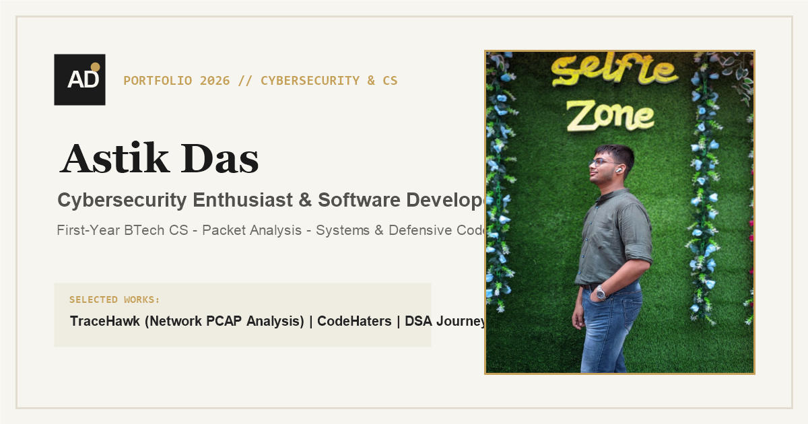
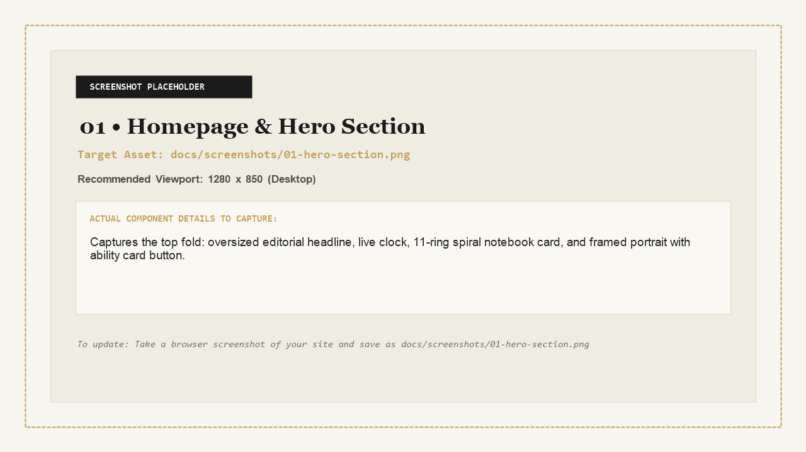
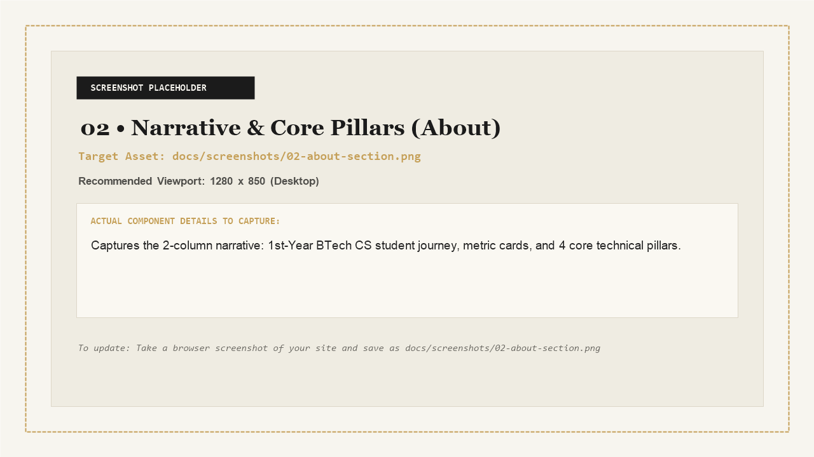
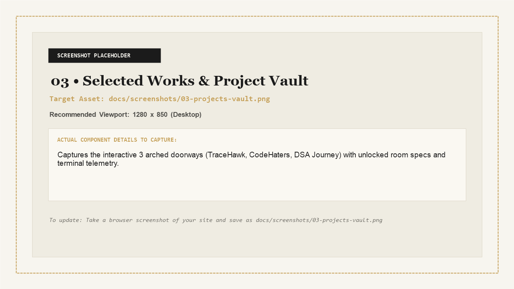
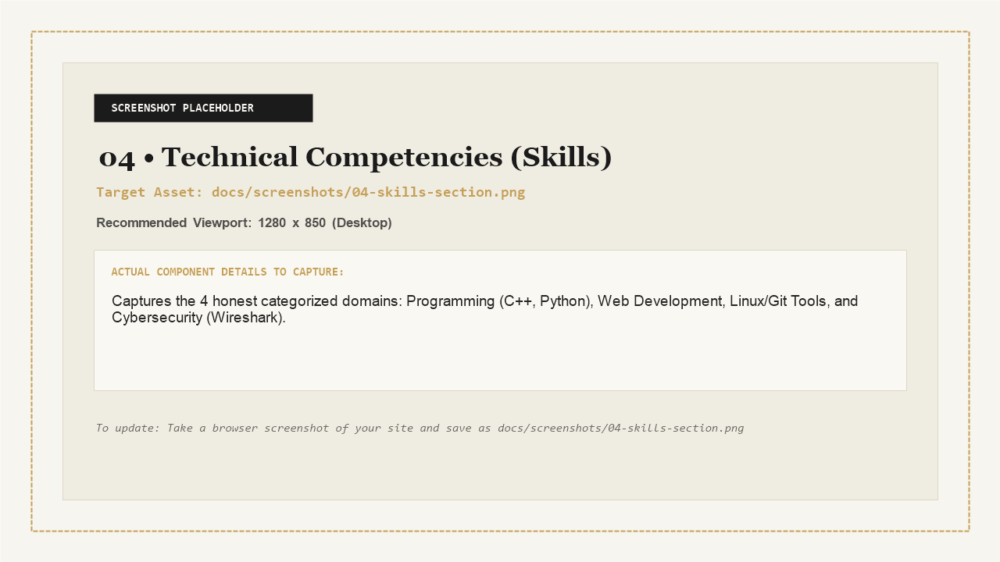
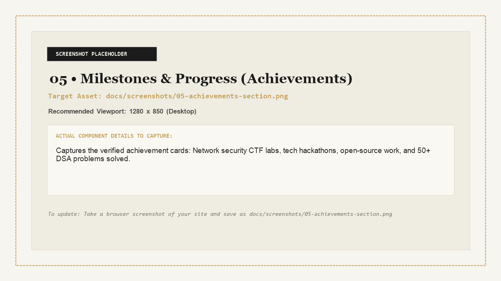
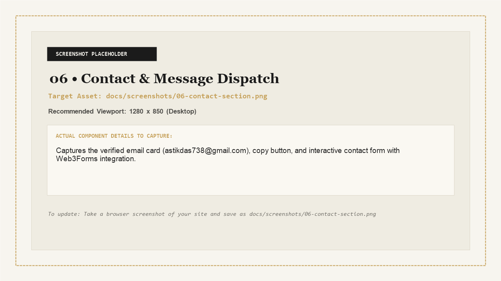
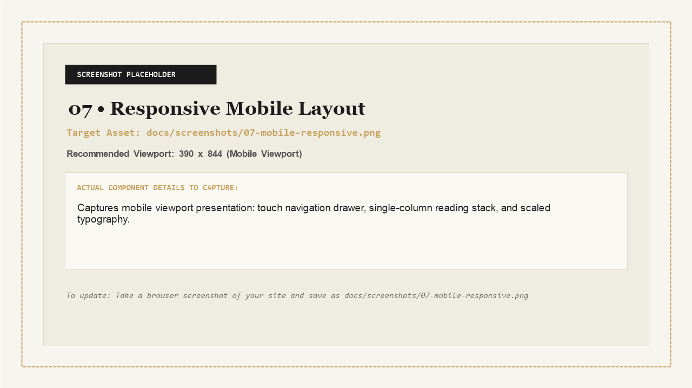
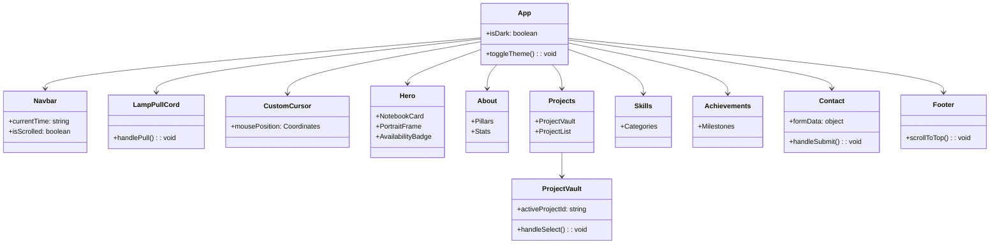

# Astik Das — Personal Portfolio Website



> An editorial-grade, responsive, and performance-optimized personal portfolio website built with **React 18**, **Vite 5**, **TypeScript**, **Tailwind CSS**, and **Framer Motion**. Designed with an archival aesthetic, tactile Web Audio feedback, interactive project showcases, and strict production security standards.

[](https://react.dev/)
[](https://www.typescriptlang.org/)
[](https://vitejs.dev/)
[](https://tailwindcss.com/)
[](https://www.framer.com/motion/)
[](LICENSE)

---

## Table of Contents

- [Live Website and Repository Links](#live-website-and-repository-links)
- [Website Screenshots and Visual Preview](#website-screenshots-and-visual-preview)
- [Project Overview](#project-overview)
- [Features and Functionality](#features-and-functionality)
- [Technology Stack](#technology-stack)
- [Architecture and Project Structure](#architecture-and-project-structure)
- [Technical Highlights & Engineering Practices](#technical-highlights--engineering-practices)
- [Security and Performance Considerations](#security-and-performance-considerations)
- [Local Inspection](#local-inspection)
- [Author and Contact Information](#author-and-contact-information)
- [License](#license)

---

## Live Website and Repository Links

| Resource | URL |
| :--- | :--- |
| **Live Website** | [https://astikdas11.github.io/myPortfolio/](https://astikdas11.github.io/myPortfolio/) |
| **GitHub Repository** | [https://github.com/astikdas11/myPortfolio](https://github.com/astikdas11/myPortfolio) |

---

## Website Screenshots and Visual Preview

*All visual preview assets are cataloged in [`docs/screenshots/`](docs/screenshots/). For instructions on updating or capturing full-resolution browser snapshots using native browser DevTools, refer to the [Screenshot Capture Guide](docs/screenshots/README.md).*

### 1. Homepage and Hero Section


- **Components Shown**: [`Navbar.tsx`](src/components/layout/Navbar.tsx), [`NotebookCard.tsx`](src/components/hero/NotebookCard.tsx), [`PortraitFrame.tsx`](src/components/hero/PortraitFrame.tsx), [`AvailabilityBadge.tsx`](src/components/common/AvailabilityBadge.tsx), [`LampPullCord.tsx`](src/components/common/LampPullCord.tsx).
- **Visual & Functional Elements**:
  - Top navigation bar featuring the personal monogram logo, anchor navigation links, live local time clock (`Local time 2:00pm`), and the "Let's talk" CTA pill.
  - Left column: Editorial headline with warm serif accents, active availability badge with pulsing status dot, and the interactive 11-ring spiral notebook card (click to flip roles with tactile audio).
  - Primary call-to-action buttons: "Explore My Work" with directional arrow and "Let's Connect" secondary ghost button.
  - Right column: Portrait frame with atmospheric gradient glow, photograph-to-vector toggle, and the "My ability card" button that opens an educational specifications drawer.
  - Hanging brass lamp cord at top-right for switching between Daylight Cream and Dark Studio themes.

---

### 2. Narrative and Core Pillars (About Section)


- **Components Shown**: [`About.tsx`](src/components/sections/About.tsx).
- **Visual & Functional Elements**:
  - Two-column editorial layout with watermarked academic year background typography (`2026`).
  - Left column: Deep narrative highlighting the author's focus on defensive engineering, network packet analysis, and operating systems, accompanied by live status and academic metrics ("Year 1 BTech CSE", "3+ Active Projects", "100% Curiosity Driven").
  - Right column: Four distinct focus pillar cards featuring Lucide icons:
    - **Cybersecurity & Defenses** (Wireshark packet flows, protocol anomalies, secure design).
    - **Algorithms & Problem Solving** (C++ data structures and algorithmic complexity).
    - **Continuous CS Journey** (Systems architectures and operating systems).
    - **Open Source & Practical Tools** (TraceHawk and collaborative utilities).

---

### 3. Selected Works and Interactive Project Vault


- **Components Shown**: [`ProjectVault.tsx`](src/components/sections/ProjectVault.tsx), [`Projects.tsx`](src/components/sections/Projects.tsx).
- **Visual & Functional Elements**:
  - Interactive "Behind the doors" vault featuring three distinct arched entryways with brass nameplates and keyholes:
    - **Door 1 (Deep Navy)**: *TraceHawk* (Network PCAP packet inspection and threat timeline reconstruction).
    - **Door 2 (Emerald Forest)**: *CodeHaters* (Full-Stack Next.js 16 + FastAPI university group allocation platform).
    - **Door 3 (Umber Brown)**: *DSA Journey* (C++ data structures, algorithms, and complexity practice).
  - Selecting an active door opens an unlocked room stage showing project specifications, key capabilities, technology badges, repository links, and an interactive simulated terminal executing real-time CLI commands.
  - Followed by a comprehensive 3-column project index cataloging technologies, repository links, and live demos.

---

### 4. Technical Competencies and Domain Knowledge


- **Components Shown**: [`Skills.tsx`](src/components/sections/Skills.tsx).
- **Visual & Functional Elements**:
  - Four categorized cards presenting practical engineering abilities without arbitrary percentage bars:
    - **Programming**: C++ (OOP, STL, memory awareness), Python (packet parsing, automation), JavaScript.
    - **Web Development**: Semantic HTML5, modern CSS3, responsive layouts, and Tailwind CSS.
    - **Tools & Environments**: Linux CLI, Bash scripting, Git atomic commits, and GitHub collaboration.
    - **Cybersecurity**: TCP/IP stack, OSI model, Wireshark packet capture analysis, and OWASP Top 10 hygiene.
  - "Core Focus" highlight badges emphasizing primary systems and defensive specializations.

---

### 5. Milestones and Growth (Achievements Section)


- **Components Shown**: [`Achievements.tsx`](src/components/sections/Achievements.tsx).
- **Visual & Functional Elements**:
  - Four structured milestone cards displaying verified timeline progress:
    - *Network Security Fundamentals & Labs* (TryHackMe & practical lab challenges).
    - *College Tech Ideathon & Hackathon* (Rapid prototyping and collaborative problem solving).
    - *Open Source Community Contributions* (Developer tooling, documentation, and issue triage).
    - *Algorithmic Problem Solving Milestone* (50+ curated solutions in C++).
  - Clean card footers with status dates and category badges.

---

### 6. Contact and Direct Message Dispatch


- **Components Shown**: [`Contact.tsx`](src/components/sections/Contact.tsx).
- **Visual & Functional Elements**:
  - Left column: Verified electronic mail card (`astikdas738@gmail.com`) with a one-click clipboard copy button, external mail client trigger, and direct social cards for GitHub and LinkedIn.
  - Right column: Client contact form with real-time input bounds (Name, Email, Topic, Message), submit button, and Web3Forms serverless delivery integration.
  - Includes full confetti animation upon successful transmission and automatic fallback to native mail client handling.

---

### 7. Responsive Mobile and Tablet Experience


- **Components Shown**: Responsive layouts across [`Navbar.tsx`](src/components/layout/Navbar.tsx) and all section views.
- **Visual & Functional Elements**:
  - Touch-accessible hamburger menu opening a backdrop-blur slide-out navigation drawer with live time readout.
  - Single-column reading flow optimized for mobile viewports (375px to 768px).
  - Hardware-adapted interactions: custom magnetic cursor automatically disables on touch devices, and animations respect OS-level reduced motion preferences.

---

## Project Overview

This repository houses the personal portfolio website of **Astik Das**, a first-year BTech Computer Science & Engineering student specializing in cybersecurity, network protocol analysis, and systems programming.

The site is built with an **editorial publication aesthetic**:
- **Warm Ivory Canvas**: A calming paper-tone light mode (`#F7F5EF`) paired with an obsidian olive dark studio theme (`#121312`).
- **Physical Depth & Skeuomorphism**: A metallic 11-ring spiral notebook card with page-turning animations, an interactive hanging brass lamp cord for toggling themes, and arched doorway vaults with brass nameplates.
- **Synthesized Haptics**: Built-in sound effects generated on-the-fly via the browser's native **Web Audio API**, producing physical page-turn and cord-pull clicks without loading audio media files over the network.
- **Zero-Backend Architecture**: Static single-page application served via edge CDNs, utilizing client-side form routing and strict Content Security Policies.

---

## Features and Functionality

| Feature | Description | File Reference |
| :--- | :--- | :--- |
| **Interactive Spiral Notebook** | An 11-ring metallic coil notebook card that flips through role descriptions on click or keyboard navigation, triggering procedural page-turn sounds. | [`src/components/hero/NotebookCard.tsx`](src/components/hero/NotebookCard.tsx) |
| **Arched Project Vault** | An interactive 3-door gallery representing major projects (TraceHawk, CodeHaters, DSA Journey). Unlocks architectural summaries and simulated terminal execution logs. | [`src/components/sections/ProjectVault.tsx`](src/components/sections/ProjectVault.tsx) |
| **Hanging Lamp Pull Cord** | A spring-physics pull cord anchored at the top-right header that toggles daylight cream and dark studio modes with sound feedback and `localStorage` persistence. | [`src/components/common/LampPullCord.tsx`](src/components/common/LampPullCord.tsx) |
| **Live Local Time Widget** | Header clock formatted dynamically to reflect local time (`Local time 2:00pm • 3 Nov 2026`) matching the editorial aesthetic. | [`src/components/layout/Navbar.tsx`](src/components/layout/Navbar.tsx) |
| **Portrait Frame & Ability Modal** | Portrait photo with fallback vector silhouette, accompanied by an interactive modal detailing core technical specifications and academic focus. | [`src/components/hero/PortraitFrame.tsx`](src/components/hero/PortraitFrame.tsx) |
| **Direct Contact Dispatch** | Validated contact form connected to Web3Forms API with character limits, canvas-confetti celebratory effects, and an automatic `mailto:` client fallback. | [`src/components/sections/Contact.tsx`](src/components/sections/Contact.tsx) |
| **Magnetic Follower Cursor** | Custom spring-physics cursor with hover enlargement on interactive elements; automatically disabled on touch devices and for users who prefer reduced motion. | [`src/components/common/CustomCursor.tsx`](src/components/common/CustomCursor.tsx) |
| **Web Audio Sound Engine** | Procedural audio generator using native oscillators, exponential ramps, and biquad filters for zero-latency, zero-asset tactile clicks. | [`src/utils/sound.ts`](src/utils/sound.ts) |

---

## Technology Stack

### Core Framework and Languages

| Technology | Version | Purpose in Project |
| :--- | :--- | :--- |
| **React** | `18.3.1` | Component-based user interface architecture and state management. |
| **TypeScript** | `5.6.3` | Static type safety, strict interface contracts, and compilation verification. |
| **Vite** | `5.4.10` | Next-generation frontend tooling providing rapid HMR and Rollup-based production builds. |

### Styling and Presentation

| Technology | Version | Purpose in Project |
| :--- | :--- | :--- |
| **Tailwind CSS** | `3.4.14` | Utility-first styling with custom editorial color palettes, shadows, and typography. |
| **PostCSS** | `8.4.47` | CSS transformation engine for processing Tailwind directives. |
| **Autoprefixer** | `10.4.20` | Vendor prefix parser ensuring cross-browser CSS compatibility. |

### Animation and Interaction

| Technology | Version | Purpose in Project |
| :--- | :--- | :--- |
| **Framer Motion** | `11.11.11` | Declarative spring animations, gesture tracking, layout transitions, and presence unmounting. |
| **Canvas Confetti** | `1.9.3` | High-performance HTML5 canvas particle explosion upon successful message dispatch. |
| **Lucide React** | `0.454.0` | Minimalist, tree-shakable SVG iconography across all components. |

### Audio and Services

| Technology | Layer | Purpose in Project |
| :--- | :--- | :--- |
| **Web Audio API** | Native Browser API | Client-side audio oscillator synthesis for tactile clicks without network bandwidth usage. |
| **Web3Forms** | Third-Party API | Serverless form forwarding endpoint routing contact inquiries straight to the author's email. |

---

## Architecture and Project Structure

### Repository Directory Tree

```
myPortfolio/
├── .github/
│   └── workflows/
│       └── deploy.yml           # GitHub Actions automated Pages CI/CD workflow
├── docs/
│   └── screenshots/             # Visual documentation preview assets
├── public/
│   ├── astik-portrait-opt.jpg   # Optimized portrait asset
│   ├── favicon.svg              # Minimalist AD monogram SVG favicon
│   ├── og-image.png             # 1200x630 Open Graph / Twitter social preview
│   ├── portrait-placeholder.svg # Minimalist vector silhouette fallback
│   ├── robots.txt               # Search engine crawler permissions
│   └── sitemap.xml              # XML sitemap index
├── src/
│   ├── components/
│   │   ├── common/              # Shared UI utilities
│   │   │   ├── AvailabilityBadge.tsx # "Open to opportunities" pulsing badge
│   │   │   ├── CustomCursor.tsx      # Spring-physics follower cursor
│   │   │   └── LampPullCord.tsx      # Golden cord theme toggle
│   │   ├── hero/                # Hero section composite components
│   │   │   ├── NotebookCard.tsx      # Spiral-bound flip card
│   │   │   └── PortraitFrame.tsx     # Framed portrait + ability specs modal
│   │   ├── layout/              # Structural chrome
│   │   │   ├── Footer.tsx            # Footer & back-to-top button
│   │   │   └── Navbar.tsx            # Navigation header & live clock
│   │   └── sections/            # Major page sections
│   │       ├── About.tsx             # Narrative, pillars, and student stats
│   │       ├── Achievements.tsx      # Milestones, CTF labs, and hackathons
│   │       ├── Contact.tsx           # Contact cards & interactive form
│   │       ├── Hero.tsx              # Headline, CTA buttons, and status bar
│   │       ├── Projects.tsx          # Project index catalog & code links
│   │       └── ProjectVault.tsx      # Arched doors showcase & terminal view
│   ├── data/
│   │   └── portfolioData.ts     # Single source of truth for text and projects
│   ├── types/
│   │   └── index.ts             # TypeScript interface declarations
│   ├── utils/
│   │   └── sound.ts             # Web Audio API sound generator
│   ├── App.tsx                  # Root component & theme provider
│   ├── index.css                # Global styles, scrollbar, & paper texture
│   ├── main.tsx                 # DOM mount entry point
│   └── vite-env.d.ts            # Vite client type definitions & env interfaces
├── .env.example                 # Example environment variables template
├── .gitignore                   # Git exclusion rules
├── index.html                   # HTML template with non-blocking fonts & OG tags
├── package.json                 # Dependency definitions and build scripts
├── postcss.config.js            # PostCSS configuration
├── tailwind.config.js           # Custom colors, typography, and shadows
├── tsconfig.json                # TypeScript compiler configuration
├── tsconfig.node.json           # Node configuration for Vite
├── vercel.json                  # Production security headers and SPA rewrites
└── vite.config.ts               # Bundler configuration & Rollup chunk splitting
```

### Component Hierarchy Diagram



---

## Technical Highlights & Engineering Practices

- **Zero-Latency Tactile Audio Engine**: Custom synthesized sound generator in [`src/utils/sound.ts`](src/utils/sound.ts) using the browser's native **Web Audio API** (oscillators, exponential frequency ramps, and biquad filters) to generate physical click feedback without streaming external audio media files over the network.
- **Dynamic Interactive Vault**: The "Behind the Doors" gallery runs on dynamic state management, coupling real-time architectural specifications with simulated CLI terminal execution.
- **Strict Bundle Splitting**: Configured Rollup manual chunking in [`vite.config.ts`](vite.config.ts) to isolate third-party vendor modules (`react`, `framer-motion`, `lucide-react`), keeping the main application code bundle under **88 kB** (~22 kB gzipped).
- **Edge Delivery with Defensive Security**: Built with automated CI/CD for static edge delivery with production-grade security headers (`Content-Security-Policy`, `X-Frame-Options: DENY`, `X-Content-Type-Options: nosniff`).

---

## Security and Performance Considerations

### HTTP Security Headers

When deployed on platforms supporting [`vercel.json`](vercel.json), the application enforces the following defensive HTTP headers:

```json
{
  "Content-Security-Policy": "default-src 'self'; script-src 'self' 'unsafe-inline'; style-src 'self' 'unsafe-inline' https://fonts.googleapis.com; font-src 'self' https://fonts.gstatic.com data:; img-src 'self' data: https: blob:; connect-src 'self' https://api.web3forms.com https://formspree.io; frame-ancestors 'none'; base-uri 'self'; form-action 'self' https://api.web3forms.com https://formspree.io;",
  "X-Content-Type-Options": "nosniff",
  "X-Frame-Options": "DENY",
  "Referrer-Policy": "strict-origin-when-cross-origin",
  "Permissions-Policy": "camera=(), microphone=(), geolocation=(), browsing-topics=()"
}
```

- **Content-Security-Policy (CSP)**: Locks script, font, and style execution to approved self-origins and designated font/form CDNs.
- **X-Frame-Options: DENY**: Prevents clickjacking attacks by forbidding the portfolio from being embedded in iframes.
- **X-Content-Type-Options: nosniff**: Blocks MIME-type sniffing vulnerabilities.
- **Permissions-Policy**: Restricts access to device hardware (camera, microphone, geolocation).

### Client-Side Input Validation

The contact form in [`src/components/sections/Contact.tsx`](src/components/sections/Contact.tsx) protects against buffer overflow or payload flooding by enforcing strict limits:
- Input trimming (`.trim()`) on all fields.
- Length boundaries: `name` (max 100 characters), `email` (max 100 characters), `subject` (max 150 characters), `message` (max 3000 characters).
- All outbound external links enforce `target="_blank"` with `rel="noopener noreferrer"` to prevent tab-nabbing vulnerabilities.

### Asset and Bundle Optimization

1. **Rollup Vendor Chunk Splitting**:
   Configured in [`vite.config.ts`](vite.config.ts) to separate vendor code into distinct cacheable chunks:
   - `vendor-react` (`react`, `react-dom`): ~133 kB
   - `vendor-motion` (`framer-motion`): ~122 kB
   - `vendor-icons` (`lucide-react`): ~13 kB
   - `index.js` (Application code): **~86.5 kB** (~22 kB gzipped)
2. **Non-Blocking Font Strategy**:
   Google Fonts in [`index.html`](index.html) use preconnects paired with `media="print" onload="this.media='all'"` to eliminate render-blocking CSS delays on initial paint.
3. **LCP Image Preload**:
   The hero portrait is declared via `<link rel="preload" as="image">` with explicit width and height dimensions to prevent Cumulative Layout Shift (CLS).

### Accessibility and Motion Awareness

- **Reduced Motion**: All animations and custom cursor listeners automatically honor the user's operating system preferences via `prefers-reduced-motion: reduce`.
- **Keyboard Navigation**: Form inputs, interactive cards, and doors feature visible focus rings, semantic HTML tags, and accessible `aria-expanded` and `aria-label` tags.

---

## Local Inspection

For technical reviewers or recruiters wishing to test or inspect the codebase locally:

```bash
# Install dependencies
npm install

# Start local development server (http://localhost:5173)
npm run dev

# Run production TypeScript verification and build
npm run build
```

---

## Author and Contact Information

**Astik Das**  
*First-Year BTech Computer Science & Engineering Student*  
*Cybersecurity Enthusiast & Software Developer*

- **Website**: [https://astikdas11.github.io/myPortfolio/](https://astikdas11.github.io/myPortfolio/)
- **GitHub**: [@astikdas11](https://github.com/astikdas11)
- **LinkedIn**: [linkedin.com/in/astik-das-253145310/](https://www.linkedin.com/in/astik-das-253145310/)
- **Email**: [astikdas738@gmail.com](mailto:astikdas738@gmail.com)

---

## License

Copyright &copy; 2026 Astik Das. All rights reserved.

This is a personal portfolio repository. Permission is granted to view, download, clone, and inspect the code locally solely for personal evaluation, educational inspection, or recruitment review. Copying, commercial reproduction, or unauthorized use of the author's likeness, personal branding, photographs, or original project content is strictly prohibited. See the [LICENSE](LICENSE) file for complete terms.
